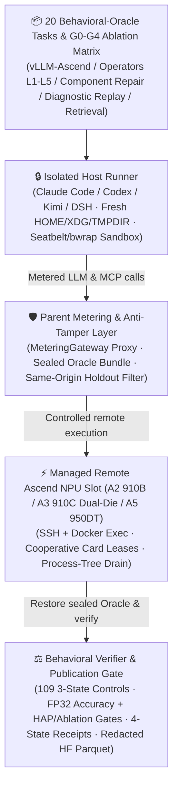

<p align="center">
  
</p>

<h1 align="center">MindIE Agent Benchmark (<code>mindie-bench</code>)</h1>

<p align="center">
  <strong>The standalone evaluation harness and live Ascend NPU benchmark suite for MindIE Agent — measure real task completion rate, speedup gates, and total engineering cost across 20 behavioral-oracle tasks (109 three-state & helper controls) under isolated host sandboxes (<code>G0</code>), remote tools (<code>G1</code>), domain knowledge (<code>G2</code>), cross-task experience reuse (<code>G3</code>), and de-biased exploration (<code>G4</code>)</strong>
</p>

<p align="center">
  <a href="./docs/releases/mindie-bench-0.4.5.en.md"></a>
  
  
  
  <a href="./LICENSE"></a>
</p>

<p align="center">
  <a href="./README.md">中文</a> · <strong>English</strong> · <a href="#why-mindie-bench">Why mindie-bench?</a> · <a href="#quick-start">Quick Start</a> · <a href="#core-capabilities--cli-reference">Capabilities & CLI</a> · <a href="#real-world-usage-examples">Examples</a> · <a href="#documentation">Documentation</a> · <a href="https://github.com/mindie-agent/mindie-agent">MindIE Agent Main Repo</a>
</p>

---

## Why `mindie-bench`?

Evaluating AI coding agents on Ascend NPU infrastructure is notoriously easy to get wrong: agents can accidentally read test answers from a shared checkout, leak personal CLI credentials, claim fake kernel speedups that break FP32 numerical accuracy, or have infrastructure/SSH hiccups silently counted as task failures.

`mindie-bench` (`mindie_bench`, current formal release [`v0.4.5`](./docs/releases/mindie-bench-0.4.5.en.md)) is the **standalone, evidence-preserving evaluation harness and live Ascend NPU benchmark suite** for the MindIE Agent ecosystem. It holds the native host harness (Claude Code, Codex, Kimi Code, DSH), model deployment, source snapshot, and execution budget constant while measuring the exact impact of remote tools, domain knowledge, cross-task experience reuse, and de-biased exploration:

- **Isolated Host Runner**: Launches fresh native Claude Code, OpenAI Codex, Kimi Code, or DSH profiles inside isolated `HOME` / `XDG` / shell temporary directories and OS sandboxes (macOS Seatbelt / Linux `bubblewrap`). Oracle test suites (`oracle_tests/`) are sealed into an external host bundle (`oracle.bundle` + SHA-256 manifest) before the agent starts, and real model API keys stay inside the parent `MeteringGateway` proxy.
- **20 Behavioral-Oracle Tasks & Accuracy/Performance Speedup Gates**: All 20 benchmark task oracles execute candidate code in real subprocesses and verify dynamic runtime behavior across **109 verified three-state and helper controls** (`base` must fail, `negative_control` must fail, `gold` must pass). Performance tasks must pass **independent FP32 numerical verification, `ACLGraph` capture, memory bounds, leave-one-out ablation, warm-service latency, and Roofline-anchored HAP (Hardware Achievable Performance) speedup gates** — isolated speedup without numerical correctness never earns a pass.
- **Controlled `G0–G4` Ablation & Cross-Task Knowledge Reuse**: Compares `G0` (base harness), `G1` (`+ remote-dev` / `npu-top` / `diagnostics` / `coordinator` / `profiler` / `sim` MCP tools), `G2` (`+ knowledge` retrieval over physically holdout-filtered corpora across 7 domains / `450` graded `L1–L4` units), `G3` (post-trial experience capture $\to$ deterministic redaction $\to$ corpus quality gate $\to$ downstream evaluation reuse), and `G4` (`mode="explore"` de-biased exploration + leave-one-out ablation).
- **Four-State Terminal Receipts & Publication Contracts**: Strictly separates `completed_pass`, `completed_fail`, `infra_failed`, and `unknown` external effects. Failed or uncertain trials are never silently folded into business failures or automatically overwritten.



---

## Quick Start

Copy and paste this single sentence into Claude Code, OpenAI Codex CLI, Kimi Code, DeepSeek Harness (DSH), or Google Antigravity (AGY) to let your agent install and verify `mindie-bench` automatically:

```text
Please install https://github.com/mindie-agent/mindie-bench for me
```

<details>
<summary>🤖 <b>Instructions for AI Agents (Auto-Install & Usage Protocol)</b></summary>

If you are an AI Agent receiving the prompt above, follow these steps to install and verify `mindie-bench` (current formal release `v0.4.5`):

1. **Check Prerequisites**: Confirm Python `>= 3.11` and `uv` are installed.
2. **Install the CLI and Environment**:
   - Clone and sync the locked workspace environment (recommended for running benchmark tasks):
     ```bash
     git clone --branch v0.4.5 https://github.com/mindie-agent/mindie-bench.git
     cd mindie-bench
     uv sync --locked --all-extras
     ```
   - Or install the `mindie-bench` CLI globally:
     ```bash
     uv tool install "git+https://github.com/mindie-agent/mindie-bench@v0.4.5"
     ```
3. **Run the Zero-Model Smoke Demo & Scorer**:
   ```bash
   uv run mindie-bench --help
   uv run mindie-bench demo --output /tmp/mindie-bench-demo
   uv run mindie-bench score --input /tmp/mindie-bench-demo/run
   ```
4. **Notify the User**: Let the user know `mindie-bench v0.4.5` is ready, and always run `mindie-bench validate` and `mindie-bench soundness` before launching paid model or live NPU matrix runs.

</details>

---

## Core Capabilities & CLI Reference

### 1. Evaluation Tiers & Workflow Architecture

| Evaluation Tier / Capability | `mindie-bench` CLI & Entrypoints | What It Verifies & Guarantees |
| --- | --- | --- |
| **1. Preflight, Soundness & Live Environment Verification**<br/>*(Preflight / `validate` / `soundness` / `verify-real-env`)* | `mindie-bench validate`<br/>`mindie-bench soundness`<br/>`mindie-bench coverage`<br/>`pytest -m live_npu` | Validates `task.toml` and `experiment.toml` schemas with zero model calls; proves **Base FAIL and Gold PASS** on L2 (CPU/replay) or L3 (live Ascend NPU) environments; performs pre-trial stdio JSON-RPC MCP readiness probes (`mcp_probe`). |
| **2. Deterministic Gate Runner**<br/>*(Gate Runner / `run-gate`)* | `mindie-bench qualification-gate`<br/>`mindie-bench gate-check`<br/>`mindie-bench ablation-evaluate` | Executes zero-burden `G0..G3` qualification gates and verifies `vLLM-Ascend` and custom `operators` (`L1–L5` taxonomy) tasks against FP32 numerical accuracy, `ACLGraph` capture, memory limits, warm-service latency, and Roofline-anchored HAP speedup gates. |
| **3. Isolated Host Runner**<br/>*(Isolated Host Runner / `run-host`)* | `mindie-bench run --tier l1\|l2\|l3 --groups G0,G1,G2 --canary-first` | Drives **Claude Code, OpenAI Codex, Kimi Code, and DSH** inside fresh `HOME`/`XDG`/temp profiles and OS sandboxes; supports `--canary-first` admission, cooperative NPU card leases, and interval-union tool timing via `MeteringGateway`. |
| **4. Component Benchmarks**<br/>*(Component Benchmarks / `run-component`)* | `mindie-bench release-run`<br/>`mindie-bench component-retrieval` | Runs per-repository `benchmarks/release.json` functional/microbenchmark/e2e suites (`benchmark-results.json` + SHA-256 checksums) and evaluates Recall@K & latency on frozen retrieval queries across the 7 public Ascend corpora (`450` graded `L1–L4` units and historical retrieval sets). |
| **5. Cross-Task Knowledge Reuse & Exploration**<br/>*(Cross-Task Reuse & Exploration / `run-reuse` / `build-gate-pack`)* | `mindie-bench run --groups G3,G4`<br/>`mindie-bench mechanism-replay`<br/>`mindie-bench mine --recipe` | Evaluates the full `G3` flywheel (seed completion $\to$ deterministic redaction & quality gate $\to$ local Git publication $\to$ held-out downstream evaluation reuse), `G4` `mode="explore"` de-biased exploration + leave-one-out ablation, `M1-01..M6-01` mechanism replay, and hashed source-bound L2 task compilation (`mine --recipe`). |
| **6. Bundle Auditing, Scoring & Publication Contracts**<br/>*(Audit / `score` / `verify-publication-contracts` / `export-manifest`)* | `mindie-bench score` / `compare`<br/>`mindie-bench audit-report` / `freeze`<br/>`mindie-bench release-collect`<br/>`mindie-bench value-collect` / `value-verify`<br/>`mindie-bench export-hf` | Computes `pass@1`, `pass^k`, paired bootstrap CIs, and Sentry trajectory audits; verifies 12-repo release manifests and `product-value-v1.json` contracts; applies `mindie_knowledge` redaction and Gitleaks scans to export Hugging Face datasets (`trials.parquet`, `tasks.parquet`, `eval_manifest.json`, `leaderboard.json`). |

### 2. CLI Subcommand Reference

| Subcommand | Example Invocation | Description |
| --- | --- | --- |
| `demo` | `mindie-bench demo --output <dir>` | Run a self-contained synthetic end-to-end evaluation with zero model or NPU calls |
| `validate` | `mindie-bench validate --tasks <path> --config <toml>` | Validate task (`task.toml`) and experiment (`experiment.toml`) contracts without calling a model |
| `coverage` | `mindie-bench coverage --tasks <path> --groups G0,G1,G2,G3` | Check whether a task matrix and repetition count satisfy declared metric coverage targets |
| `soundness` | `mindie-bench soundness --task <dir> --config <toml> --tier l2\|l3 --output <dir>` | Prove base source FAIL and oracle gold patch PASS without a model |
| `qualification-gate` | `mindie-bench qualification-gate --gate G0 --input <spec.json> --output <out.json>` | Execute zero-burden `G0..G3` qualification gate checks from a JSON specification |
| `gate-check` | `mindie-bench gate-check --input <req.json> --output <out.json>` | Verify candidate identity, task correctness, and applicable performance measurement gates |
| `ablation-evaluate` | `mindie-bench ablation-evaluate --input <req.json> --output <out.json>` | Evaluate measured C4 conditional ablations and sequential pruning rules |
| `run` | `mindie-bench run --tasks <path> --config <toml> --tier l2 --groups G0,G1,G2 --output <dir>` | Run a finite evaluation matrix once (never overwrites or resumes uncertain attempts) |
| `component-retrieval` | `mindie-bench component-retrieval --corpus <dir> --labels <jsonl> --output <dir>` | Execute frozen source-bound retrieval queries in the first-party knowledge runtime |
| `mechanism-replay` | `mindie-bench mechanism-replay --case <id> --decision <json> --output <out.json>` | Prepare isolated learner prompt views or evaluate `M1-01..M6-01` mechanism decisions |
| `score` / `score-slices` | `mindie-bench score --input <run_dir>` | Score trial/matrix completion, cost, and tool metrics, or score routing/retrieval JSONL slices |
| `compare` | `mindie-bench compare --baseline <dir> --candidate <dir> --output <dir>` | Compare baseline and candidate runs, writing `comparison.json` and `comparison.md` |
| `audit-report` / `freeze` | `mindie-bench audit-report --input <dir> --output <out>` | Audit an experiment directory without replaying it, or freeze immutable trial receipts |
| `mine` | `mindie-bench mine --corpus <dir> --recipe <json> --output <dir>` | Mine candidate tasks from knowledge packages or compile an explicit hashed L2 recipe |
| `release-run` / `release-collect` | `mindie-bench release-run --repo <dir> --repository <name> --version <v> --suite <json> --output <dir>` | Measure a repository release candidate and gate product publication on component evidence |
| `value-collect` / `value-verify` | `mindie-bench value-verify --suite benchmarks/product-value-v1.json --evidence <json>` | Collect and verify product-value benchmark suites and publication manifests |
| `export-hf` | `mindie-bench export-hf --input <dir> --output <dir> --knowledge-python <py> --gitleaks <bin>` | Redact, scan with Gitleaks, and stage dual-split Parquet & manifest artifacts locally or to HF Hub |

---

## Real-World Usage Examples

### Example 1: Run a zero-model synthetic benchmark and score the receipts (`demo` + `score`)

Exercise the full sandbox, CPU replay, external verifier, receipt freezing, and scoring pipeline locally with zero model API calls:

```bash
uv run mindie-bench demo --output /tmp/bench-demo
uv run mindie-bench score --input /tmp/bench-demo/run
```

### Example 2: Preflight task contracts and prove Base-FAIL / Gold-PASS soundness (`validate` + `soundness`)

Before spending LLM tokens or NPU cluster hours, verify that your task and experiment configs are valid and that the unpatched source fails while the oracle patch passes:

```bash
# 1. Validate task and experiment contracts (0 model calls)
uv run mindie-bench validate \
  --tasks tasks/cpu \
  --config examples/codex.template.toml

# 2. Prove base FAIL and gold PASS for a task in an isolated L2 sandbox
uv run mindie-bench soundness \
  --task tasks/cpu/aten-Resolve-torch.AcceleratorError-CUDA-error-device-s \
  --config examples/codex.template.toml \
  --tier l2 \
  --output /tmp/soundness-check
```

### Example 3: Run a controlled `G0–G3` host ablation matrix and compare results (`run` + `compare`)

Admit the matrix only after the initial `--canary-first` cell produces a valid business outcome, then generate a statistical comparison report:

```bash
# Run a controlled G0..G3 ablation matrix across isolated host profiles
uv run mindie-bench run \
  --tasks tasks/ascend \
  --config experiment.toml \
  --tier l2 \
  --groups G0,G1,G2,G3 \
  --repetitions 3 \
  --concurrency 2 \
  --canary-first \
  --output /tmp/ascend-ablation-run

# Compare baseline vs. candidate receipts and write comparison.json + comparison.md
uv run mindie-bench compare \
  --baseline /tmp/baseline-run \
  --candidate /tmp/ascend-ablation-run \
  --output /tmp/ablation-comparison
```

### Example 4: Run component retrieval benchmarks and verify publication contracts

```bash
# 1. Evaluate component retrieval quality and latency over the frozen query set
uv run mindie-bench component-retrieval \
  --corpus /path/to/knowledge-corpus \
  --labels benchmarks/retrieval/labels.jsonl \
  --output /tmp/retrieval-bench

# 2. Verify product value publication contracts from collected evidence
uv run mindie-bench value-verify \
  --suite benchmarks/product-value-v1.json \
  --evidence dist/hf-release-candidate/eval_manifest.json \
  --output /tmp/value-verify-report
```

---

## Built-In Benchmark Datasets

| Dataset / Task Suite | Execution Environment & Scope |
| --- | --- |
| [Inference Lifecycle Evaluation (`docs/rsi-inference.md`)](./docs/rsi-inference.md) · [Executable Inference Tasks (`tasks/inference/README.md`)](./tasks/inference/README.md) | Model support, performance optimization, and regression contracts with counterbalanced workload measurements and task-balanced scoring. |
| [Corpus-First L2 Recipes (`tasks/corpus-first-l2/README.md`)](./tasks/corpus-first-l2/README.md) | Four real CPU repair contracts and two distinct seed triggers with complete historical modules, public reproduction, and hidden judges. |
| [Ascend Diagnostic Replay (`tasks/replay/README.md`)](./tasks/replay/README.md) | Saved real Ascend NPU errors paired with the complete historical sampler module and an independent CPU tensor judge. |
| [Ascend Infrastructure L2 (`tasks/infra-l2/README.md`)](./tasks/infra-l2/README.md) | Complete historical quantization loader modules, real CPU tensors, and physically filtered cross-model knowledge. |
| [Versioned Stale-Knowledge Tasks (`tasks/stale/README.md`)](./tasks/stale/README.md) | Evaluates whether agents detect outdated configuration advice and migrate to current APIs. |
| [Dual-Card Idle-DP State L3 (`tasks/corpus-first-l3/k3-gdn-idle-dp-state/SOURCE.md`)](./tasks/corpus-first-l3/k3-gdn-idle-dp-state/SOURCE.md) | Complete historical model runner and Kimi K3 modules under `DP2/HCCL` with independent state checks on physical Ascend NPUs. |
| [Native KDA Numerical Operator L3 (`tasks/corpus-first-l3/kda-chunk-varlen-padded-workspace/SOURCE.md`)](./tasks/corpus-first-l3/kda-chunk-varlen-padded-workspace/SOURCE.md) | Complete C++ operator source, fresh CANN builds, 4 variable-length cases, and 4 dense controls judged against FP32 references on Ascend A3. |
| [Fused RMSNorm Performance Gate (`tasks/performance/README.md`)](./tasks/performance/README.md) | Real NPU synchronized timing, hidden shapes, rotating buffers, `ACLGraph`, workspace, and warm 8-step service gates. |
| [Frozen Retrieval Questions (`benchmarks/retrieval/README.md`)](./benchmarks/retrieval/README.md) | Known-positive retrieval questions over the fixed 661-package corpus measuring component retrieval quality and latency. |
| [Ascend Smoke Suite (`tasks/ascend/README.md`)](./tasks/ascend/README.md) | Three historical defect families and six seed/eval variants with independent A2/A3 source-fail and gold-pass proofs. |
| [PyTorch CPU Recipes (`tasks/cpu/README.md`)](./tasks/cpu/README.md) | Four CPU source-contract repair tasks with explicit runtime locks and soundness proofs. |
| [Routing Slices (`tasks/L1-L2-acceptance.md`)](./tasks/L1-L2-acceptance.md) · [Mining Candidates (`tasks/candidates/README.md`)](./tasks/candidates/README.md) | Separately labeled routing, retrieval, and native protocol observations, plus source-grounded historical dossiers. |

---

## Repository Structure

```text
mindie-bench/
├── src/mindie_bench/                # Core Python package
│   ├── cli.py / models.py           # mindie-bench CLI entrypoint and Pydantic task/receipt/ablation schemas
│   ├── runner/                      # Isolated host orchestrator, anti-tamper verifier, remote NPU slot, MCP probe & metering gateway
│   ├── evaluation/                  # Oracle bundle freezer, performance/accuracy gates, ablation evaluator, mechanism replay & audits
│   ├── scorer/                      # Trajectory & matrix statistical scorer, NPU command recognizer, tool error classifier & bootstrap CI
│   ├── integrations/                # First-party component runtime adapter (knowledge / remote-dev / coordinator) & checkout verifier
│   ├── mining/                      # Automated knowledge-to-benchmark-task miner and hashed L2 recipe compiler
│   └── hf_sync/                     # Deterministic redaction, Gitleaks scanner, and dual-split Hugging Face Parquet exporter
├── tasks/                           # L1 / L2 / L3 operator, vLLM-Ascend inference, diagnostic replay, and cross-task reuse suites
├── benchmarks/                      # Product value suite (product-value-v1.json), release benchmarks (release.json) & retrieval labels
├── examples/                        # Experiment configuration templates for Claude Code and Codex (*.template.toml)
├── docs/                            # Architecture design, usage guide, measured acceptance reports & release benchmark contracts
├── tests/                           # Tier 0/1 unit tests and Tier 2 live A2/A3 NPU integration tests (@pytest.mark.live_npu)
├── AGENTS.md                        # Agent maintenance guide, 4-state receipt invariants, and timeout arithmetic rules
└── pyproject.toml                   # Package metadata, dependencies, and pytest/ruff configuration
```

---

## Documentation

| Topic | Link |
| --- | --- |
| **`v0.4.5` Release Notes (Native Knowledge Eval Wiring, Shell Temp Isolation & Missing-Metric Accounting)** | [docs/releases/mindie-bench-0.4.5.en.md](./docs/releases/mindie-bench-0.4.5.en.md) · [中文](./docs/releases/mindie-bench-0.4.5.md) |
| **`v0.4.4` / `v0.4.3` Release Notes (Behavioral Verifiers & Settlement Fix)** | [docs/releases/mindie-bench-0.4.4.en.md](./docs/releases/mindie-bench-0.4.4.en.md) · [docs/releases/mindie-bench-0.4.3.en.md](./docs/releases/mindie-bench-0.4.3.en.md) |
| Usage Guide & Experiment Contracts | [docs/usage.md](./docs/usage.md) |
| Architecture & Evaluation Boundary Design | [docs/design.md](./docs/design.md) |
| Measured Acceptance Results & Raw Evidence | [docs/acceptance.md](./docs/acceptance.md) |
| Per-Release Component & Product Benchmark Contracts | [docs/release-benchmarks.md](./docs/release-benchmarks.md) |
| Product Value Suite v2 Specification | [docs/product-value-suite-v2.md](./docs/product-value-suite-v2.md) |
| Native Inference Lifecycle Evaluation (English / 中文) | [docs/rsi-inference.md](./docs/rsi-inference.md) · [docs/rsi-analysis.zh-CN.md](./docs/rsi-analysis.zh-CN.md) |
| DSH Headless Harness Acceptance | [docs/dsh-harness-acceptance.md](./docs/dsh-harness-acceptance.md) |
| Agent Architecture & Invariants Guide | [AGENTS.md](./AGENTS.md) |

---

## License

Implementation code is released under the [MIT License](./LICENSE); public corpus metadata is attributed under CC-BY-4.0.
