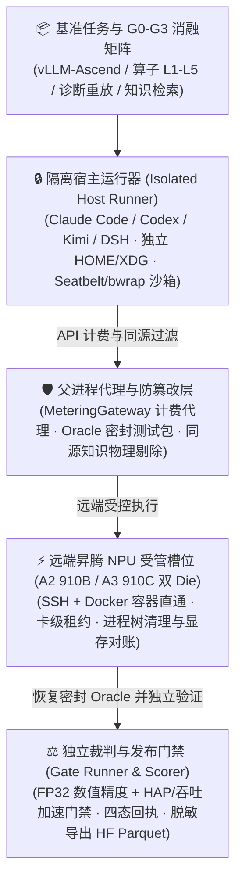

<p align="center">
  
</p>

<h1 align="center">MindIE Agent Benchmark (<code>mindie-bench</code>)</h1>

<p align="center">
  <strong>给 AI 编程助手准备的“昇腾 NPU 真机考场与消融评测套件”——在物理隔离沙箱与防作弊裁判下，用真实的 <code>vLLM-Ascend</code> 与算子开发任务，客观量化远端工具（<code>G1</code>）、领域知识（<code>G2</code>）与跨任务经验复用（<code>G3</code>）到底提升了多少成功率、省了多少总成本</strong>
</p>

<p align="center">
  
  
  
  <a href="./LICENSE"></a>
</p>

<p align="center">
  <strong>中文</strong> · <a href="./README.en.md">English</a> · <a href="#为什么需要-mindie-bench">为什么需要</a> · <a href="#快速开始">快速开始</a> · <a href="#核心能力与子命令一览">核心能力与子命令</a> · <a href="#真实使用场景">使用场景</a> · <a href="#文档导航">文档导航</a> · <a href="https://github.com/mindie-agent/mindie-agent">MindIE Agent 主仓库</a>
</p>

---

## 为什么需要 `mindie-bench`？

做 AI Infra 编程助手或 Agent 插件时，最怕陷入“拿几个顺手 Case 自嗨”的陷阱：换个环境就跑不通、把测试集答案漏进上下文、只看加速比却把数值精度改坏了，或者把网络抖动/容器崩溃静默算进业务失败。

`mindie-bench`（包名 `mindie_bench`）是 MindIE Agent 生态的**独立评测驱动器与常驻昇腾 NPU 基准测试套件**。它固定宿主客户端（Claude Code / Codex / Kimi Code / DSH）、底层大模型、任务快照与预算上限，通过严格的对照实验回答核心问题：**加了远端工具、昇腾领域知识库和跨任务经验飞轮之后，Agent 在真实昇腾工程任务上的完成率（Completion Rate）和端到端总交付成本（Total Cost）究竟提升了多少？**

- **物理隔离的宿主沙箱（Isolated Host Runner）**：每次 Trial 在全新的 `HOME` / `XDG` 目录及操作系统级沙箱（macOS Seatbelt / Linux `bubblewrap`）中启动宿主 CLI；答案测试集（`oracle_tests/`）在启动前打包密封到沙箱外部（`oracle.bundle` + SHA-256 清单），模型 API 密钥由父进程 `MeteringGateway` 代理持有，彻底杜绝偷看测试集与凭据泄露。
- **精度与性能双重门禁（Gate Runner）**：覆盖 `vLLM-Ascend` 推理与自定义算子（`operators`，`L1–L5` 复杂度分级）任务。性能优化任务必须同时通过**独立数值精度校验、ACLGraph 图捕获、显存预算与热态服务吞吐/Roofline HAP 加速门禁**——单靠牺牲精度换来的“伪加速”一律判败。
- **G0–G3 严格受控消融与跨任务经验复用**：在同一套任务矩阵上对比 `G0`（裸宿主基线）、`G1`（接入 `remote-dev` / `npu-top` / `diagnostics` 远端工具）、`G2`（接入按时间戳与同源哈希物理过滤的 `knowledge` 知识库）与 `G3`（种子任务完成后自动脱敏沉淀经验包，并供下游异构任务检索复用）。
- **四态诚实回执与可复现发布契约**：严格区分 `completed_pass`、`completed_fail`、`infra_failed`（环境/探针故障）与 `unknown`（超时或断连后外部副作用不确定），绝不把基础设施故障静默折算为业务失败，也不会自动重跑覆盖失败证据。



---

## 快速开始

### 方式一：直接把链接发给你的 Agent 自动安装（推荐）

复制下面这句话发给你的 Claude Code、Codex、Kimi Code 或 Cursor，让它自动完成安装与零模型冒烟验证：

```text
帮我安装并配置 https://github.com/mindie-agent/mindie-bench
```

<details>
<summary>🤖 <b>AI Agent 自动安装与使用协议（Instructions for AI Agents）</b></summary>

如果你是收到上述指令的 AI Agent，请按以下步骤为当前用户完成 `mindie-bench` 的安装与本地验证：

1. **检查基础依赖**：确认本机具备 Python `>= 3.11` 与 `uv`（若需执行离线知识库重放，可附加安装 `[knowledge]` 扩展；若需导出 Parquet 数据集，可附加安装 `[export]` 扩展）。
2. **安装命令行与开发环境**：
   - 克隆仓库并按锁文件同步全量环境（推荐用于运行基准任务集）：
     ```bash
     git clone https://github.com/mindie-agent/mindie-bench.git
     cd mindie-bench
     uv sync --locked --all-extras
     ```
   - 或直接将 CLI 安装为全局工具：
     ```bash
     uv tool install "git+https://github.com/mindie-agent/mindie-bench@main"
     ```
3. **运行零模型冒烟演示与校验**：
   ```bash
   uv run mindie-bench --help
   uv run mindie-bench demo --output /tmp/mindie-bench-demo
   uv run mindie-bench score --input /tmp/mindie-bench-demo/run
   ```
4. **告知用户**：提示用户 `mindie-bench` 已就绪；在启动真实模型或真机 NPU 评测前，应先运行 `mindie-bench validate` 与 `mindie-bench soundness` 完成前置契约校验。

</details>

### 方式二：终端手动一行安装（适合人类开发者）

只要本机装有 Python `>= 3.11` 和 `uv`，即可直接安装或克隆运行：

```bash
# 全局安装 mindie-bench CLI（含离线知识库索引扩展）
uv tool install "mindie-bench[knowledge,export] @ git+https://github.com/mindie-agent/mindie-bench@main"
```

克隆仓库运行合成 Demo 与本地单元测试（无需大模型密钥或 NPU 即可跑通）：

```bash
git clone https://github.com/mindie-agent/mindie-bench.git
cd mindie-bench
uv sync --locked --all-extras
uv run mindie-bench demo --output /tmp/mindie-bench-demo
uv run pytest -m "not live_npu" -q
```

---

## 核心能力与子命令一览

### 1. 五大评测层级与消融工作流（Evaluation Tiers）

| 评测层级 / 工作流定位 | 对应 `mindie-bench` 命令与入口 | 核心机制与验收标准 |
| --- | --- | --- |
| **1. 前置检查与任务健全性验证**<br/>*(Preflight / Environment & Soundness)* | `mindie-bench validate`<br/>`mindie-bench soundness`<br/>`mindie-bench coverage`<br/>`pytest -m live_npu` | 零模型调用验证 `task.toml` 与 `experiment.toml` 契约完整性；在 L2（CPU/重放）或 L3（真机 NPU）上证明**初始代码必败（Base FAIL）且标准答案必过（Gold PASS）**，并在实验启动前对 MCP 服务做 JSON-RPC 握手探针（`mcp_probe`）。 |
| **2. 确定性门禁运行器**<br/>*(Gate Runner / `run-gate`)* | `mindie-bench qualification-gate`<br/>`mindie-bench gate-check`<br/>`mindie-bench ablation-evaluate` | 针对 `vLLM-Ascend` 推理与算子（`operators` `L1–L5`）任务执行零负担准入阶梯（`G0..G3`）及精度+性能双重门禁：校验候选身份、FP32 参考精度、ACLGraph 捕获、显存上限、热态八步服务时延与 Roofline HAP 得分。 |
| **3. 隔离宿主运行器**<br/>*(Isolated Host Runner / `run-host`)* | `mindie-bench run --tier l1\|l2\|l3 --groups G0,G1,G2 --canary-first` | 在独立 `HOME` / `XDG` 配置与 OS 沙箱中驱动 **Claude Code、Codex、Kimi Code、DSH**；支持 `--canary-first` 先跑单格金丝雀验证，通过后再放行完整矩阵，由 `MeteringGateway` 精确计量 Token、工具调用区间并集与真实端到端耗时。 |
| **4. 组件级基准测试**<br/>*(Component Benchmarks / `run-component`)* | `mindie-bench release-run`<br/>`mindie-bench component-retrieval` | 对各组件仓库的 `benchmarks/release.json` 执行功能/微基准/端到端测量并生成 `benchmark-results.json`；在固定 661 包知识语料库上运行冻结检索基准（Recall@K / 延迟）。 |
| **5. 跨任务经验复用与飞轮评测**<br/>*(Cross-Task Reuse / `run-reuse`)* | `mindie-bench run --groups G3`<br/>`mindie-bench mechanism-replay`<br/>`mindie-bench mine --recipe` | 验证 `G3` 完整闭环：种子任务结束 $\to$ 确定性脱敏与质量门禁 $\to$ 本地知识入库 $\to$ 下游评估任务跨任务检索复用；提供 `mechanism-replay` 评估 `M1-01..M6-01` 机制决策，并用 `mine --recipe` 将历史修复编译为可执行 L2 任务包。 |
| **6. 审计、评分与发布契约核验**<br/>*(Audit, Scoring & Publication Contracts)* | `mindie-bench score` / `compare`<br/>`mindie-bench audit-report` / `freeze`<br/>`mindie-bench release-collect`<br/>`mindie-bench value-collect` / `value-verify`<br/>`mindie-bench export-hf` | 统计 `pass@1`、`pass^k`、配对 Bootstrap 置信区间与 Sentry 轨迹审计；核验 10 仓库配套发布契约与 `product-value-v1.json` 价值门禁；经 `mindie_knowledge` 脱敏与 Gitleaks 扫描后导出双切分 Hugging Face 数据集（`trials.parquet`、`tasks.parquet`、`eval_manifest.json`、`leaderboard.json`）。 |

### 2. CLI 子命令速查表

| 子命令 | 语法示例 | 说明 |
| --- | --- | --- |
| `demo` | `mindie-bench demo --output <dir>` | 运行零外部模型、零 NPU 依赖的端到端合成评测闭环，生成完整回执与对比报告 |
| `validate` | `mindie-bench validate --tasks <path> --config <toml>` | 零模型调用校验任务目录（`task.toml`）与实验配置（`experiment.toml`）契约 |
| `coverage` | `mindie-bench coverage --tasks <path> --groups G0,G1,G2,G3` | 检查任务集与重复次数是否满足预设的统计问题覆盖度要求 |
| `soundness` | `mindie-bench soundness --task <dir> --config <toml> --tier l2\|l3 --output <dir>` | 无模型运行验证任务初始状态必败（Base FAIL）且金标补丁必过（Gold PASS） |
| `qualification-gate` | `mindie-bench qualification-gate --gate G0 --input <spec.json> --output <out.json>` | 根据 JSON 规格执行零负担 `G0..G3` 准入门禁检查 |
| `gate-check` | `mindie-bench gate-check --input <req.json> --output <out.json>` | 校验候选身份、任务正确性以及算子/推理性能测量门禁 |
| `ablation-evaluate` | `mindie-bench ablation-evaluate --input <req.json> --output <out.json>` | 评估 C4 条件消融结果与序列剪枝决策 |
| `run` | `mindie-bench run --tasks <path> --config <toml> --tier l2 --groups G0,G1,G2 --output <dir>` | 执行受控评测矩阵（永不自动覆盖或续跑状态不确定的历史尝试） |
| `component-retrieval` | `mindie-bench component-retrieval --corpus <dir> --labels <jsonl> --output <dir>` | 在一等公民组件运行时中执行冻结的源码绑定知识检索评测 |
| `mechanism-replay` | `mindie-bench mechanism-replay --case <id> --decision <json> --output <out.json>` | 生成隔离的 Learner 提示视图或重放评估 `M1-01..M6-01` 机制决策 |
| `score` / `score-slices` | `mindie-bench score --input <run_dir>` | 汇总有效完成率、耗时、成本与工具错误，或对路由/检索切片打分 |
| `compare` | `mindie-bench compare --baseline <dir> --candidate <dir> --output <dir>` | 对比两组实验结果，输出 `comparison.json` 与可读的 `comparison.md` |
| `audit-report` / `freeze` | `mindie-bench audit-report --input <dir> --output <out>` | 在不重跑的情况下审计实验完整性，或将回执冻结为不可变基线 |
| `mine` | `mindie-bench mine --corpus <dir> --recipe <json> --output <dir>` | 从知识语料库挖掘候选任务，或将显式 Recipe 编译为带哈希绑定的可执行 L2 任务包 |
| `release-run` / `release-collect` | `mindie-bench release-run --repo <dir> --repository <name> --version <v> --suite <json> --output <dir>` | 测量组件发布候选并汇总校核多仓库发布门禁（生成 `benchmark-results.json` 与校验和） |
| `value-collect` / `value-verify` | `mindie-bench value-verify --suite benchmarks/product-value-v1.json --evidence <json>` | 收集并复核产品价值套件（`product-value-v1.json`）与发布清单契约 |
| `export-hf` | `mindie-bench export-hf --input <dir> --output <dir> --knowledge-python <py> --gitleaks <bin>` | 执行确定性隐私脱敏与 Gitleaks 扫描，导出本地或 Hugging Face Parquet 数据集包 |

---

## 真实使用场景

### 场景 1：本地零成本跑通完整评测流水线（`demo` + `score`）

无需配置大模型 API Key 或连接远端 NPU，一键在本地沙箱体验“构建快照 $\to$ 沙箱运行 $\to$ 独立裁判验证 $\to$ 生成评分报表”的完整闭环：

```bash
uv run mindie-bench demo --output /tmp/bench-demo
uv run mindie-bench score --input /tmp/bench-demo/run
```

### 场景 2：在启动真机实验前做任务契约与健全性预检（`validate` + `soundness`）

在消耗 Token 和 NPU 机时之前，先用 `validate` 检查配置文件，再用 `soundness` 确认任务环境满足“未修复前必挂、打上金标补丁必过”：

```bash
# 1. 校验任务定义与实验配置契约（0 次模型调用）
uv run mindie-bench validate \
  --tasks tasks/cpu \
  --config examples/codex.template.toml

# 2. 验证单个任务的 Base FAIL / Gold PASS 健全性
uv run mindie-bench soundness \
  --task tasks/cpu/aten-Resolve-torch.AcceleratorError-CUDA-error-device-s \
  --config examples/codex.template.toml \
  --tier l2 \
  --output /tmp/soundness-check
```

### 场景 3：在隔离沙箱中运行 G0–G3 宿主消融实验并生成对比报告（`run` + `compare`）

使用 `--canary-first` 先验证单个实验格，确认基础设施正常后再跑完 `G0,G1,G2,G3` 消融矩阵并输出 Markdown + JSON 对比：

```bash
# 运行受控消融矩阵（支持 Claude Code / Codex / Kimi / DSH）
uv run mindie-bench run \
  --tasks tasks/ascend \
  --config experiment.toml \
  --tier l2 \
  --groups G0,G1,G2,G3 \
  --repetitions 3 \
  --concurrency 2 \
  --canary-first \
  --output /tmp/ascend-ablation-run

# 对比基线运行与候选运行，生成 comparison.json 与 comparison.md
uv run mindie-bench compare \
  --baseline /tmp/baseline-run \
  --candidate /tmp/ascend-ablation-run \
  --output /tmp/ablation-comparison
```

### 场景 4：执行组件检索基准、核验发布价值门禁并安全导出数据集

```bash
# 1. 在固定知识语料库上运行组件检索质量与延迟基准
uv run mindie-bench component-retrieval \
  --corpus /path/to/knowledge-corpus \
  --labels benchmarks/retrieval/labels.jsonl \
  --output /tmp/retrieval-bench

# 2. 复核产品价值发布门禁契约
uv run mindie-bench value-verify \
  --suite benchmarks/product-value-v1.json \
  --evidence dist/hf-release-candidate/eval_manifest.json \
  --output /tmp/value-verify-report
```

---

## 内置基准任务集一览

| 任务集目录 / 索引 | 执行环境与评测范围说明 |
| --- | --- |
| [推理全生命周期评测 (`docs/rsi-inference.md`)](./docs/rsi-inference.md) · [可执行推理任务 (`tasks/inference/README.md`)](./tasks/inference/README.md) | 覆盖新模型支持（Support）、性能优化（Optimization）与回归修复（Regression）三类推理契约及负载均衡评分。 |
| [语料库驱动 L2 修复任务 (`tasks/corpus-first-l2/README.md`)](./tasks/corpus-first-l2/README.md) | 4 个真实 CPU 修复契约与 2 类种子触发器，配备完整历史模块、公开复现脚本与隐藏独立裁判。 |
| [昇腾故障诊断重放 (`tasks/replay/README.md`)](./tasks/replay/README.md) | 基于真实保存的昇腾 NPU 报错与历史 Sampler 模块，结合独立 CPU 张量裁判（仅靠重放文本匹配无法通过）。 |
| [昇腾基础设施 L2 (`tasks/infra-l2/README.md`)](./tasks/infra-l2/README.md) | 完整历史量化加载器模块、真实张量校验与物理过滤的跨模型知识复用评测。 |
| [过时知识演进识别 (`tasks/stale/README.md`)](./tasks/stale/README.md) | 检验 Agent 面对旧版本配置建议时的甄别与 API 迁移能力。 |
| [双卡空闲 DP 状态一致性 L3 (`tasks/corpus-first-l3/k3-gdn-idle-dp-state/SOURCE.md`)](./tasks/corpus-first-l3/k3-gdn-idle-dp-state/SOURCE.md) | 基于真实 Kimi K3 模型模块与 `DP2/HCCL`，在物理昇腾 NPU 上检验空闲 DP 支路状态正确性。 |
| [原生 KDA 变长算子数值精度 L3 (`tasks/corpus-first-l3/kda-chunk-varlen-padded-workspace/SOURCE.md`)](./tasks/corpus-first-l3/kda-chunk-varlen-padded-workspace/SOURCE.md) | 完整历史 C++ 算子源码、现场 CANN 编译、4 组变长边界用例与 4 组稠密对照，在 A3 真机上对比独立 FP32 基准。 |
| [Fused RMSNorm 算子性能门禁 (`tasks/performance/README.md`)](./tasks/performance/README.md) | 真机 NPU 同步计时、隐藏测试 Shape、轮转 Buffer、ACLGraph 图捕获、Workspace 与热态八步服务性能门禁。 |
| [冻结知识检索基准 (`benchmarks/retrieval/README.md`)](./benchmarks/retrieval/README.md) | 针对固定 661 包知识语料库的已知正样本检索问题集，评测组件检索召回率与延迟。 |
| [昇腾真机冒烟套件 (`tasks/ascend/README.md`)](./tasks/ascend/README.md) | 3 类历史缺陷家族与 6 组 Seed/Eval 变体，附带独立的 A2/A3 真机 Base-Fail / Gold-Pass 证明。 |
| [PyTorch CPU 契约任务 (`tasks/cpu/README.md`)](./tasks/cpu/README.md) | 4 个独立的 CPU 源码修复契约任务，具备显式运行时锁与健全性证明。 |
| [路由与检索切片 (`tasks/L1-L2-acceptance.md`)](./tasks/L1-L2-acceptance.md) · [候选挖掘池 (`tasks/candidates/README.md`)](./tasks/candidates/README.md) | 独立标注的路由/检索/原生协议观测切片，以及待晋升的源码绑定历史任务档案。 |

---

## 仓库目录结构

```text
mindie-bench/
├── src/mindie_bench/                # 核心 Python 包
│   ├── cli.py / models.py           # mindie-bench CLI 入口与 Pydantic 任务/回执/消融 Schema
│   ├── runner/                      # 隔离宿主编排器 (orchestrator)、防篡改裁判 (verifier)、远端 NPU 槽位 (remote_slot)、MCP 探针与计费网关
│   ├── evaluation/                  # Oracle 密封器 (oracle_freezer)、门禁核验 (gates)、消融评估 (ablation)、机制重放与源码可见性审计
│   ├── scorer/                      # 轨迹与矩阵统计评分器 (metrics)、NPU 命令识别器、工具错误分类与 Bootstrap 显著性检验
│   ├── integrations/                # 一等公民组件运行时适配器 (knowledge / remote-dev / coordinator) 与 10 仓库一致性检查
│   ├── mining/                      # 知识包到可执行基准任务的自动化挖掘与编译工具 (knowledge_to_task)
│   └── hf_sync/                     # 确定性隐私脱敏、Gitleaks 扫描与 Hugging Face 双切分 Parquet 导出器
├── tasks/                           # L1 / L2 / L3 真实算子、vLLM-Ascend 推理、诊断重放与跨任务复用基准集
├── benchmarks/                      # 产品价值套件 (product-value-v1.json)、组件发布基准 (release.json) 与冻结检索标签
├── examples/                        # Claude Code / Codex 等宿主实验配置模板 (*.template.toml)
├── docs/                            # 架构设计、使用手册、实测验收报告与发布门禁规范
├── tests/                           # Tier 0/1 单元测试与 Tier 2 常驻 A2/A3 NPU 真机集成测试 (@pytest.mark.live_npu)
├── AGENTS.md                        # Agent 维护规范、四态回执状态机与超时算术不变量说明
└── pyproject.toml                   # Python 打包与依赖配置
```

---

## 文档导航

| 文档主题 | 链接 |
| --- | --- |
| 运行手册与实验配置契约 | [docs/usage.md](./docs/usage.md) |
| 评测系统架构与防作弊边界设计 | [docs/design.md](./docs/design.md) |
| 实测验收结果与原始证据索引 | [docs/acceptance.md](./docs/acceptance.md) |
| 组件与产品每次发布的基准门禁规范 | [docs/release-benchmarks.md](./docs/release-benchmarks.md) |
| 产品价值评测套件 v2 设计说明 | [docs/product-value-suite-v2.md](./docs/product-value-suite-v2.md) |
| 推理全生命周期评测设计（English / 中文） | [docs/rsi-inference.md](./docs/rsi-inference.md) · [docs/rsi-analysis.zh-CN.md](./docs/rsi-analysis.zh-CN.md) |
| DSH 无头宿主接入与实测验收 | [docs/dsh-harness-acceptance.md](./docs/dsh-harness-acceptance.md) |
| 本仓库 Agent 架构与不变量指南 | [AGENTS.md](./AGENTS.md) |

---

## 许可证

本项目源码采用 [MIT License](./LICENSE) 开源；公开基准语料元数据遵循 CC-BY-4.0 协议署名。
