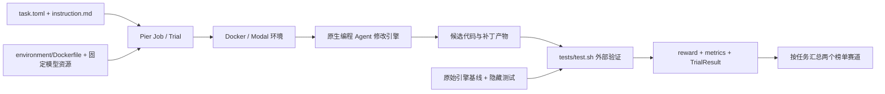
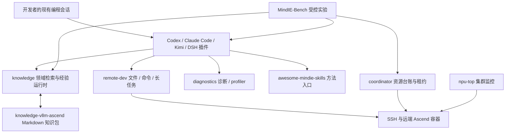
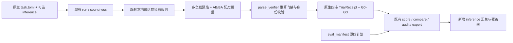

# RSI-Inference Bench、MindIE-Agent 与 MindIE-Bench：源码分析与集成

分析日期：2026-10-20。本文分析已克隆的真实源码，而不是仅复述项目介绍。
RSI 基线为 `a6b10af282014412b4eae14f3105d68555889821`，MindIE-Bench
改动前基线为 `b7301839602ad3791af17f21f5aa47d773b5af2a`。
原生重构随后合入最新主线 `3bf7fa6`（PR #7，MindIE-Bench 0.4.0）；
下文原始能力对比保留初始源码快照，新增主线能力见 §4.5。
所有生态仓库的精确版本及完整 37 任务清单见 [源码快照](rsi-source-snapshot.json)。

用户提供的[微信公众号文章](https://mp.weixin.qq.com/s/6yPyBDCfbCqdxP68TU37Tg)
在本次访问时无法读取，未将其内容当作已核实证据。官方
[源码](https://github.com/apple-aiml-research/ml-rsi-inference-bench/tree/a6b10af282014412b4eae14f3105d68555889821)
与[榜单源文件](https://github.com/apple-aiml-research/ml-rsi-inference-bench/blob/a6b10af282014412b4eae14f3105d68555889821/docs/leaderboard.html)
均已在本地核对。榜单的数据快照时间是 **2026-10-12 05:39 UTC**，不能把它当成 10 月 20 日重新跑出的实验。

## 1. 核心判断

RSI-Inference 研究“编程 Agent 能否在长时间预算内改善真实推理系统”；
MindIE-Agent 为现有编程客户端提供 Ascend 工程知识、远端执行和经验复用；
MindIE-Bench 研究这些能力是否提高任务完成率、降低完整交付成本。
三者的关系是**工程能力底座、受控评测框架与真实工程任务集互补**。

RSI 的 self-improving 主要指 Agent 修改推理系统代码，不能直接解释为模型更新自身权重、
无限递归自进化，或已经证明跨任务经验增长。MindIE 的 G3 才专门把 seed、采集、发布、
独立 consumer/eval 接起来，检验跨任务经验复用。

本次将 RSI 的方法重构为 MindIE 原生能力：可选的生命周期任务契约、配对多负载测量、
回归保护项、原生裁判证据校验，以及按任务等权的汇总。它们直接接入既有
`TaskSpec → run/soundness → private verifier → TrialReceipt → score/compare/export`。
无需 Apple checkout、Pier 或外部回执格式。PR #6 初版的 `rsi-*` 适配入口已移除。
**本次内化的是通用评测机制；未宣称原始 37 题已经移植到 Ascend 或完成真实硬件验收。**

## 2. Apple RSI-Inference Bench

### 2.1 评测对象与覆盖

逐个解析 `tasks/*/task.toml` 得到：

| 维度 | 已发布实现 |
| --- | --- |
| 生命周期 | 新模型支持 10；推理性能优化 20；性能回归修复 7 |
| 引擎 | vLLM 20；SGLang 17 |
| 硬件 | H100 17；B200 20 |
| 每题卡数 | 1 卡 7；2 卡 6；4 卡 14；8 卡 10 |
| Agent 时间 | 37 题均为 30,000 秒，即约 8.33 小时 |
| 裁判时间 | 各任务不同，3,600–158,330 秒；不能把 Agent 时限当成整个任务总时限 |
| Agent 网络 | 37 题均声明 `allow_internet=false` |
| 裁判容器 | 9 个模型支持任务显式 `separate`；其余任务使用默认共享环境模式 |

任务涉及 MoE、混合/线性/稀疏注意力、推测解码、低精度权重、图像输入及扩散生成等。
覆盖面是推理系统工程，不是单一算子微基准或纯问答准确率。
例如 Qwen 27B 优化任务同时考察 decode-heavy、prefill-heavy、high-load；
多模态回归任务测首 token 延迟，并保留其他负载作为性能不回退的 guard。

### 2.2 分层架构



顶层 `pyproject.toml` 的包名是 `inference-bench`、Python 要求为 3.12+，
使用本地 editable `third_party/pier`，并非依赖任意最新版 PyPI Pier。
Pier 是 Harbor 的派生框架；上游基点、Apache-2.0 LICENSE/NOTICE 和 Apple 修改说明
保存在 `ACKNOWLEDGEMENTS` 与第三方目录中。

典型任务结构：

```text
tasks/<id>/
  task.toml                 资源、时间、任务类别、评分与引擎/模型身份
  instruction.md            给 Agent 的任务要求
  environment/Dockerfile    构建可复现执行环境
  environment/...           公共脚本、资源、模型清单
  tests/test.sh             裁判入口
  tests/...                 精度、隐藏用例、服务与性能验证
  solution/...              参考修复/补丁（存在时由 oracle 路径消费）
```

实现入口见 `third_party/pier/src/pier/cli/jobs.py`、`job.py`、
`trial/trial.py`、`trial/execution.py`、`trial/artifact_handler.py`。
模型和引擎的具体安装与验收主要在各任务目录，不在一个统一的 GPU 执行函数中。

`agents/factory.py` 与 `agents/installed/` 接入 Codex、Claude Code、Cursor、
Gemini、OpenCode、mini-swe-agent 等；`nop`、`oracle` 提供控制组入口。
`environments/docker/` 和 `environments/modal.py` 负责环境。
`models/task/config.py`、`models/task/verifier_mode.py` 解析资源和独立裁判配置；
`verifier/verifier.py` 投放测试并读出奖励。

“离线”需要分阶段理解：容器构建和 Agent 安装可能访问网络；推理 API 仍须可达，
Pier 利用 Agent 的安装声明和允许域名列表放行必要路径。它不是彻底断开所有网络的模型。
也不能从 `allow_internet=false` 单个字段推断任意部署已经安全隔离，必须核对后端实际行为。

### 2.3 三类裁判的工程机制

**模型支持。** 任务从尚未支持目标模型的固定引擎版本出发。Agent 要交付可构建、可加载、
数值可靠、服务路径可用且满足效率要求的实现。很多任务有独立 verifier image，
把捕获的候选修改转移到新的裁判环境，避免直接信任 Agent 的工作环境。
GPT-OSS 示例含 Harmony、MXFP4、隐藏验收及独立效率节点；超时/阻塞可通过
`reward.txt=-1` 表示作废，不能当普通零分。

**性能优化。** 以
`tasks/optimize_qwen3_6_27b_1xh100_open/tests/verify_throughput_real.py` 为例：
检查运行环境和候选编辑范围，测正确性，运行 candidate/pristine 两组负载，
收集有效样本，计算每负载吞吐比并取几何平均。任务内配对/交替测量降低 GPU 漂移影响。
无修改或只改配置等不符合题目目标的候选可以被门禁拒绝；缺失样本、原始基线失败与
候选失败有不同处理路径。`metrics.json` 中的部分测量是诊断证据，不一定可计分。

**回归修复。** 历史缺陷绑定真实父版本、参考修复和测量目标。
例如 `regression_multimodal_prefill_ttft` 源码解释了 Triton 将变化的 token 数
作为 constexpr 引发重编译的问题；目标是恢复真实服务 TTFT。
其较小值更好，因此 ratio 为 pristine/candidate，而吞吐类为 candidate/pristine。
`tests/_verifier_lib/regression_scoring.py` 还处理噪声门槛、guard 回退和未测量状态。
不能仅寻找某段补丁文本就宣告修复成功。

### 2.4 分数、榜单与结论边界

支持赛道的任务分数为“完整通过次数 / 有效尝试次数”，再对任务等权平均；
部分隐藏测试通过不能算一次完整成功。优化和回归合为 27 题速度赛道，按任务加速比
计算几何平均。正确性失败的候选在速度汇总中记 1×，不是正的性能收益。

特别注意裁判内部的 `reward=max(0, speedup-1)` 与榜单展示的 speedup 不同：
0.8× 和 1.0× 都可能 reward=0，不能用 `1+reward` 恢复原始比值。
正确性通过但存在真实减速时，读取 `speedup_geomean` 才保留信息。

HTML 内嵌 `window.RSI_LEADERBOARD`，包含 37 题、12 个 Agent 条目，
`results_scored` 字段为 444（不能解释为原始尝试次数）。
该快照中 Sonnet-5.5 的支持 pass@1 为 0.2667、速度赛道为 1.6772×。
这些是官方页面的报告值，本次没有重新运行验证。最高支持率仍较低，说明端到端新模型
接入困难；高平均速度也不能保证所有模型和负载都受益。

页面还有 category-weighted Bradley–Terry Elo 风格的联合 rating，三类权重为
0.25/0.5/0.25，且部分并列使用 f2p。这个综合排名不应代替两个业务指标，
也不能仅凭原始 reward 求平均重现。当前集成保留两个赛道，未重新实现 BT 排名。

### 2.5 使用流程与复现难点

```sh
cd ml-rsi-inference-bench
uv sync --locked
uv run pier run -p tasks/<task-id> --env docker --agent <agent> --model <model>
uv run pier view --help
```

先选择真实硬件符合要求的任务，再准备容器运行时、对应模型权重、足够存储/共享内存和
Agent API 配置。先做小规模 canary，再扩展任务矩阵。保存 jobs、候选补丁、
原始基线/候选测量、精度结果、版本及 GPU 信息。

工程限制包括：高额时间和硬件成本；任务专用验证代码较多；模型/镜像依赖可发生漂移；
公开历史修复可能污染 Agent 的预训练数据；少量样本不应解释为稳定因果结论。
本次还发现 Qwen 27B 的 `instruction.md` 工具链文字与 `task.toml` 描述不一致，
应以 Dockerfile、锁文件及真实容器探测为复现依据，不能只复制任务介绍。
有些 target revision 是标签而非 40 位 SHA，须在实际运行证据中保留最终解析版本。

## 3. MindIE-Agent 设计、实现与使用

### 3.1 多仓不是 Git submodule 树

主仓当前没有 `.gitmodules`，职责是架构、领域边界、设计原则及交付文档。
仅运行 `git clone --recurse-submodules mindie-agent` 并不会拿到整个生态。
本次根据 README/architecture 的仓库关系，分别克隆主仓、4 个插件仓、5 个共享运行时仓、
MindIE-Bench、领域知识仓、技能仓，共 13 个 MindIE 仓库，外加 Apple 仓库。
这些均位于任务工作目录下的同级目录，未安装或更改用户生产插件配置。

### 3.2 分层和组件职责



| 仓库 | 实现入口与职责 | 阅读/使用重点 |
| --- | --- | --- |
| mindie-agent | `docs/architecture.md`、`design-principles.md`、配套发布文档 | 主仓不承载统一业务执行服务器 |
| mindie-agent-codex | `plugins/mindie-agent/.codex-plugin/plugin.json`、`.mcp.json`、`scripts/native_entry.py`、`native_hooks.py`、`setup.py` | 原生任务身份、会话 Hook、MCP、锁定运行时与更新 |
| mindie-agent-cc | `scripts/entry.py`、`identity.py`、`transcript.py`、`organizer.py`、`mcp_server.py` | Claude 会话生命周期、公开 transcript 和后台整理 |
| mindie-agent-kimi | `kimi.plugin.json`、`scripts/mcp_server.py`、`with_runtime.py` | Kimi 原生插件及 wire.jsonl 对话接入 |
| mindie-agent-dsh | `host.mjs`、`host3.mjs`、`package.json`、`scripts/setup.py` | Node Host 插件组合稳定 skill/MCP 插件，版本 generation 切换 |
| knowledge | `mindie_knowledge/loop/`、`materials/`、`community/`、`retrieval.py`、`redact.py` | 游标、分块正文、检索派生索引、授权采集与发布 |
| knowledge-vllm-ascend | Markdown 任务导航与知识正文 | 领域内容；不能与执行引擎混同 |
| remote-dev | `remote_dev/mcp/server.py`、`mcp/tools.py`、`core/`、`processes/` | JSON-RPC stdio、SSH、文件编辑、作业取消/轮询与产物 |
| coordinator | `mindie_coordinator/cli.py`、`ops.py`、`task_server.py`、runtime/lease 模块 | 机器/容器配置、探测、NPU 与服务端口租约、受管任务 |
| diagnostics | `mindie_diagnostics/`、`mindie_profiler/` | 有界本地诊断、支持包、受授权控制的上报、Ascend profile 分析 |
| npu-top | `npu_top/cli.py`、采样后端、`app/` 前端 | NPU 占用、集群指标和本地 Web 监控 |
| awesome-mindie-skills | 顶层 README 及分领域 Skill 资源 | 渐进披露的领域方法，独立于基础运行时 |
| mindie-bench | `src/mindie_bench/`、`tasks/`、`benchmarks/` | 工具贡献、知识贡献和经验贡献的独立度量 |

源码中的版本不完全等于主仓架构文档列出的配套发布版本：本次 checkout 的
remote-dev 为 0.10.3、coordinator 为 0.6.0、diagnostics 为 0.5.0、
npu-top 为 0.2.0、mindie-bench 为 0.3.0，而主仓部分表格仍引用较早配套版本。
knowledge 为 0.12.2。部署应使用插件锁文件确定的组件组合，不能把所有 main 的最新
代码任意组合后宣称与既有 release 验收相同。

### 3.3 知识闭环的数据流

Hook 负责轻量记录当前任务的公开增量，重整理放在后台。正文经确定性脱敏后存为
`tasks/<task-id>/blocks/<hash>.md`，导航在 `index.md`；小模型生成标题与摘要，
不把隐含思维过程、工具原始载荷等充作公开知识。Git 管理发布内容，SQLite 管理本地
游标/队列/授权和回执，Markdown 是正文来源。

`materials/reme_index.py` 等实现 ReMe 技术词切分、BM25/文件图谱与增量索引，
不应根据某些旧插件 README 中的 FTS5 描述断言当前检索只是一张 FTS 表。
用户授权的贡献范围、发布目标和开关独立于插件安装；反馈为辅助信号。
知识命中只表示可参考，必须检查版本、适用条件和验证证据。

`remote-dev` 的 MCP 服务器把普通工具执行与短作业控制分到不同线程池，避免长命令
阻塞取消/状态查询；SSH 远端执行和物理 NPU 租约是不同职责。
`coordinator` 提供机器、容器、probe、lease、runtime 等稳定入口，
`npu-top` 偏人类可视化观测。`diagnostics` 则负责异常可定位与 profiler 分析。

### 3.4 使用方式

用户在自己的业务源码仓和现有编程客户端中使用对应 MindIE 插件，
以 `/mindie-agent` 或宿主对应 Skill 入口唤起领域知识；远端文件、命令和测试由
`remote-dev` MCP 处理。第一次需要选择机器、容器、凭据和是否贡献知识。
知识贡献不是执行远端开发的必需条件。

仅需远端基础工具时，可独立安装对应版本的 remote-dev 并以
`remote-dev server` 启动 stdio MCP；coordinator 提供 `task-server` 等入口。
完整插件安装以各插件当前 release 的 README 与 compatibility/lock 文件为准。
本次任务是分析与代码集成，未执行主仓 README 中的插件安装、Star、知识 PR 发布协议。

## 4. MindIE-Bench 的设计结构与工程实现

### 4.1 评测的两个轴

| 轴 | 含义 |
| --- | --- |
| L0 | 无模型、无 NPU 的确定性契约和组件测量 |
| L1 | 有界原生 Harness / 工具路由任务 |
| L2 | 隔离源码工作区，真实 CPU 执行或明确标注的 replay，外部最终裁判 |
| L3 | 真实 Linux Ascend 容器、卡租约、进程与内存检查 |
| G0 | 原生 Harness 基线 |
| G1 | 加远端工具 |
| G2 | 再加经过时间/同源隔离的公共知识 |
| G3 | 再加 seed→采集→独立 eval 的实际经验流 |

L 与 G 是正交维度；L3 不意味着某个 G 已成立。
固定模型、Harness、任务、预算、源码与硬件身份后，才能估计工具/知识的贡献。

### 4.2 源码调用链

```text
cli.py
  -> models.py / TaskSpec、ExperimentConfig
  -> runner/orchestrator.py / run_matrix -> run_trial
     -> profile_builder.py（G0–G3 原生配置与过滤知识）
     -> sandbox.py / source_projection.py（可见源码与系统隔离）
     -> mcp_probe.py（真实组件握手）
     -> gateway.py / knowledge_broker.py（模型计量与知识访问）
     -> drivers/{codex,claude_code,kimi,dsh}.py
     -> evaluation/oracle_freezer.py + runner/verifier.py
     -> remote_slot.py（L3 SSH、容器与 NPU）
     -> TrialReceipt
  -> scorer/{metrics,comparator,components,slices}.py
  -> release / value / hf_sync 输出
```

`models.py` 使用 Pydantic 严格字段契约。任务 `schema_version=1.0`，含
task、mindie_knowledge、budget、environment、oracle、performance。
environment 使用 l1/l2/l3 及 npu_model/npu_count，不能直接读取 RSI 的 1.2 TOML。
默认 Agent 时间 1,080 秒只是默认值，预算可配置；“不能跑 8 小时”不是已确认的结构性缺口。

Runner 创建干净的原生 profile 和可见源码快照；本地使用 macOS Seatbelt/Linux
bubblewrap，远端使用独立容器工作区和受管资源。不是单靠更换 HOME 或 PATH 获得隔离。
Oracle 在 Agent 启动前封存，核对保护文件；验证结果经独立协议解析。
MCP 必须实际握手成功，不能用仅仅存在配置文件替代服务可用性证据。

### 4.3 状态、计量与统计

`completed_pass`、`completed_fail`、`infra_failed`、`unknown` 分开保存。
基础设施问题、未结算模型请求、无法判断的远端副作用不能混为候选代码失败。
已开始但没有终态回执的尝试也不能从分母中消失。

原生汇总有有效尝试 pass@1、逐任务 pass^k/组合可靠性估计、总交付时间、
全尝试成本、成本完备性、工具时间区间并集、首次定位与编辑进展、知识调用与质量等。
`comparator.py` 要求成对且身份兼容的实验，不能混用变更后的硬件和模型。
原生 pass@1 是有效回执整体比例；RSI 新入口明确采用任务等权，二者没有互相替换。

已有性能门禁在 `evaluation/performance.py`：真实同步时钟、多个独立 buffer、
隐藏 shape、ACLGraph capture/replay、workspace 和 warm server 测量。
验证器将结果绑定本次 nonce 与 Oracle manifest；只有 kernel 加速不能自动通过。
因此“MindIE-Bench 没有性能验证/几何平均/正确性门禁”的结论不成立。
它缺的是原生生命周期契约、多负载配对实验与任务均衡赛道汇总，而不是所有测量原语。

### 4.4 数据集与日常使用

现有任务包括 CPU 源码修复、Ascend replay、量化加载、stale knowledge、
DP2/HCCL 状态、KDA 变长算子和 fused RMSNorm 性能。
`mining/knowledge_to_task.py` 将源码、知识、重现、gold、裁判材料编成 candidate；
`soundness` 通过真实 base-fail/gold-pass 才能提升任务证据等级。
`release-run/release-collect` 与 `value-collect/value-verify` 为组件/产品发行提供证据，
`export-hf` 在脱敏与扫描后导出，上传是显式操作。

```sh
uv sync --locked --all-extras
uv run mindie-bench validate --tasks /absolute/tasks --config experiment.toml
uv run mindie-bench coverage --tasks /absolute/tasks --groups G0,G1,G2 --repetitions 3
uv run mindie-bench run --tasks /absolute/tasks --config experiment.toml \
  --tier l2 --groups G0,G1,G2 --repetitions 3 --canary-first --output reports/run-1
uv run mindie-bench score --input reports/run-1
uv run mindie-bench compare --baseline reports/base --candidate reports/new --output reports/compare
```

`demo` 是无模型/无硬件的合成演示，但原生隔离仍依赖支持的平台；
不能因为描述为 synthetic 就认为所有 Windows 环境都能跑整个 runner。
L3 还须准备真实 SSH/容器/NPU、配套组件、租约与独立路径。

### 4.5 重构期间合入的 0.4.0 主线

PR #7 增加了产品矩阵执行（`runner/matrix.py`、`product_executor.py`）、候选门禁与
split manifest（`evaluation/gates.py`、`split_manifest.py`）、机制消融、graded
capture/consumer、经验谱系审计以及公开发行证据协议。这些模块没有被 RSI 方案替换。
`runner/phase_budget.py` 把准备、执行、结算、裁判、清理计入同一个预声明预算；
新测量器继续在既有 verifier 阶段内执行，不重新计算或延长产品实验预算。
重叠的 `models.py`、`cli.py`、`orchestrator.py` 已按最新主线合并，并增加相关
门禁、split 与 ablation 回归测试，完整结果由最终 CI 验证。

## 5. 两个 Bench 的共同点和差异

| 维度 | RSI-Inference | 原有 MindIE-Bench | 结论 |
| --- | --- | --- | --- |
| 核心问题 | Agent 改善推理引擎的能力 | 工具、知识、经验的完成率与成本贡献 | 可互补，不能以相同分数解释 |
| 任务对象 | vLLM/SGLang 的完整引擎工程 | Ascend 工程、组件、CPU/replay/NPU 多层任务 | RSI 的引擎生命周期覆盖更集中 |
| 硬件 | 1–8 H100/B200 | CPU、Ascend A2/A3 等真实远端环境 | 后端不可直接互换 |
| 数据格式 | Harbor/Pier 1.2 | MindIE 自有 1.0 | 在原生 1.0 中增加可选契约；不导入外部格式 |
| 调度 | Pier Job/Trial，Docker/Modal | 本地原生 profile + 远端 slot + G 矩阵 | 复用 MindIE 调度，避免引入第二套状态机 |
| 隔离 | 容器、网络 allowlist、部分独立 verifier | OS 沙箱、保护源码、封存 Oracle、独立知识 broker | 两者已有实现，强度依实际任务与部署 |
| 计分 | 完整支持 pass@1、测得速度比 | 完成率、可靠性、完整成本、知识/工具指标及性能门禁 | 原报告新增生命周期汇总，旧指标计算保留 |
| 性能实验 | 多负载配对基线、吞吐/TTFT/guard | 同步时钟、buffer/shape、ACLGraph/内存/服务 | 可共享方法，具体探针需适配硬件 |
| 长任务 | 所有题 30,000 秒，重构建与重裁判 | 可配预算、远端受管长任务 | 差异是已交付任务/后端，不是单一超时常量 |
| 经验闭环 | 不提供 MindIE 的 G3 因果实验 | seed/capture/consumer 与同源/时间 holdout | RSI 不能替换已有 G3 |
| 轨迹/看板 | ATIF 1.7 扩展、viewer、critique、榜单 | 原生事件与细粒度计量、比较、HF 导出 | 结果继续走 MindIE 报告与导出，不新增上游依赖 |
| 无效运行 | sentinel/infra_void/异常等任务契约 | 四终态与显式 coverage | 接口需保留，不可统统填 0 或 1× |
| 发行评估 | 主要是 Agent/模型榜单 | 多组件锁定版本、release/value gate | MindIE 独有的交付范围继续保留 |

## 6. 缺口、吸收方法与本次实现

| RSI 已实现而原 MindIE 未直接提供的能力 | 可否吸收 | 原生落点 |
| --- | --- | --- |
| 模型支持、优化、回归三类生命周期 | 可以 | `inference_models.py` 定义契约，`TaskSpec.inference` 可选启用 |
| 多工作负载基线/候选配对、预热和交替顺序 | 可以 | `evaluation/inference.py::measure_workloads`，由既有私有裁判调用 |
| 吞吐与 TTFT 等不同优化方向 | 可以 | workload 的 `metric/direction`，统一换算“越大越好”的比例 |
| scored 与 guard 分离 | 可以 | guard 必测且不进入正向收益，失败会否决候选收益 |
| 全量支持与连续加速两个赛道 | 可以 | `scorer/inference.py`，直接读取原生 TrialReceipt |
| 部分通过、无效运行与有效慢化分离 | 必须 | 支持项全过才成功；错误候选为 1×；有效慢化保留 <1；infra/unknown 不计分 |
| 原始 GPU 题、Docker/Modal、Pier Agent 管理 | 不直接搬入 | 与 Ascend 后端、既有调度重复，且会引入额外依赖与不实硬件结论 |
| ATIF viewer、critique、Bradley–Terry 排名 | 暂不吸收 | 不解决当前测量缺口；继续使用原生轨迹、比较、成本与导出体系 |

### 6.1 从源码到原生机制的推导

RSI 的 throughput `tests/_verifier_lib/scoring.py` 同时保留原始速度比与
`max(0, ratio-1)` reward。MindIE 的 `VerifierResult.reward` 和四终态要求二值一致，
因此不能把这个连续 reward 填入旧字段。新实现保留二值“是否通过验收”，另从证据重算
连续比例；正确性通过但慢化的候选仍然失败，其速度比不会被裁剪成 1。

RSI regression 的 `paired_ratio_median`、`resolve_matrix_ratio` 表明：应先按轮次配对，
再取每个负载的中位比例，最后对 scored 负载做几何平均。不能先分别平均所有基线和
候选样本再相除。例如两轮比值为 2 与 0.5 时，中位值是 1.25；两侧样本量级差异会使
“均值之比”得到完全不同的答案。新测量器明确记录 AB/BA 顺序与完整轮次，且把预热排除。

原 RSI guard 实现使用 best paired round，并允许未测 guard 不直接变成失败；
本次没有照搬这一宽松策略。MindIE 的保护项必须完整测量，并要求配对中位比达到阈值。
缺测是证据不足，已测回退是业务失败，两者不互相替换。

RSI 不可改 pristine baseline 和外部 verifier 的工程实践，与 MindIE 已有
`oracle_freezer`、`local_verifier/remote_verifier` 高度相通。新证据沿用原生 nonce 与
Oracle manifest，同时绑定源码基线、运行时、设备类型、负载哈希和候选源码哈希。
原生 parser 会重新计算门禁，不能仅信任裁判输出的 scalar reward；测量过程仍必须由
可信、受隔离的裁判控制，哈希字段本身不构成硬件或执行真实性证明。

### 6.2 具体重构链路与兼容性



- `models.py` 的新字段均可选，旧任务与旧回执继续加载；没有重写原生调度器。
- `runner/verifier.py` 的本地与远端路径共用证据校验；`soundness.py` 也传递相同契约，
  避免只在模型运行时启用门禁、在 source/gold 验证时漏掉门禁。
- `runner/orchestrator.py` 在任务开始时记录契约，因此启动失败的任务也能进入赛道覆盖统计。
  原有终态、G3 capture、资源计量、原生预算和清理逻辑不被替换。
- `scorer/metrics.py` 原有完成率、可靠性、成本等计算保留；额外增加 `inference`。
  新汇总按 group/tier/evidence/seed-eval/experiment/harness-model 条件分群。
- 先在任务内部汇总重复实验，再按任务等权；支持率用算术平均，加速比用几何平均。
  旧全局 pass@1 仍可与新增 task-balanced pass@1 并存，两个问题不混为一个指标。
- `score`、audit 与导出在存在原始 manifest 时使用它判断覆盖；缺任务、缺轮次、
  blocked、infra、unknown 或额外单元都会阻止相应赛道输出完整分数。
  无计划的历史回执只提供 observed 分数，不反推“计划全完成”。
- 原有 `PerformanceContract` 的 ACLGraph、内存、warm-server 门禁继续生效，
  新的通用吞吐/时延契约不能绕开这些设备侧要求。

代码不依赖外部 RSI 仓，也不新增 Python 运行时依赖。
`tasks/inference` 提供三类原生 CPU 示例：新请求模式支持、共享前缀计算优化、
重复前缀计算回归修复。示例真的执行子进程并计时，所有数据标为 synthetic；
不是预设加速数值，也不把示例成功解释成生产推理引擎或 NPU 成功。
具体接口、原生命令、边界见[使用说明](rsi-inference.md)。

### 6.3 Ascend 真实任务迁移应如何做

1. 选取可在现有 NPU 环境复现的引擎缺陷或优化点，建立新的 task ID；保留 RSI 来源，
   固定 vLLM/vLLM-Ascend、CANN、torch-npu、模型 revision 和容器 digest。
2. 把 CUDA/Triton/CUDA Graph/多卡通信假设改成已验收的 Ascend 实现。H100/B200 的
   精度、显存与性能基准不能直接作为 A2/A3 阈值。
3. 继承“公共重现 + 私有裁判 + 不可改基线 + 配对/轮换负载”的实验结构，
   通过现有 `PerformanceContract` 接入同步测量、ACLGraph、workspace 和 warm service。
4. 为 prefill、decode、高并发/长上下文分别定义输入输出长度、并发、精度容差、有效样本
   下限、噪声门槛和 guard；裁判同时检查源码版本、模型和实际硬件身份。
5. 先证明 base fail / gold pass 或可复现的基线与优化收益，才升级为 verified；
   然后在同一硬件/预算/模型条件下开展 G0–G3，对 seed/eval 做同源与时间隔离。
6. 单独公布原生 NPU 分数，不与原始 RSI GPU 数字合并。经验改善、引擎加速和 GPU/NPU
   性能差异属于不同问题，应分别报告。

### 6.4 许可证与依赖边界

Apple 顶层使用 Apple Sample Code License，bundled Pier/Harbor 为 Apache-2.0，
模型、数据和参考补丁另有其来源与条款。MindIE 的 MIT 声明不能覆盖这些内容。
本次独立实现原生契约、测量和评分方法，不复制 Apple 实现、测试或模型资源，
不在运行时读取上游 checkout。上游许可证属于研究来源本身，此说明记录分发边界。

## 7. 验证与未验证边界

本次验证围绕原生链路：三种任务契约、真实 CPU 子进程测量、配对估计与方向转换、
guard 与正确性失败、未知/缺测/混合版本、原生评分与公开导出，以及本地/远端裁判绑定。
Linux/macOS 端到端测试运行原生 soundness 和三任务矩阵；Windows 不绕过 OS 沙箱。
测试合成观测不代表任何模型成绩，也未运行真实 Ascend/GPU 推理任务验收。
完整测试结果、打包结果和 Linux/macOS CI 状态以 PR 中最终验证记录为准。

Windows 上原有全量原生 runner 测试不能直接作为绿色交付证据：仓库 CI 指定的是
Ubuntu/macOS；本机发现 POSIX 沙箱、`/usr/bin/true`、路径与短时间测量差异。
这些限制保持可见，不通过跳过保护机制伪造通过，也不在 RSI PR 中扩展无关 Windows
原生 runner 改造。

后续真实硬件验收应选择已有 Ascend 参考实现的原生任务，接入新契约并保存
固定基线、私有 workload、实际硬件及 source/gold 证据，再开展 G0–G3。
通用机制内化、某一引擎任务通过和知识增益是三个需要分别举证的结论。
